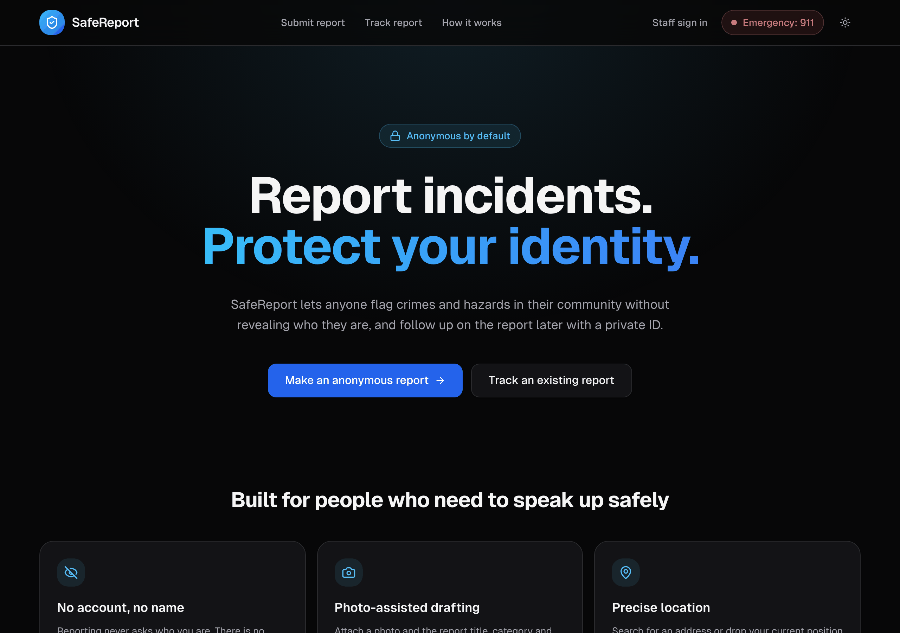
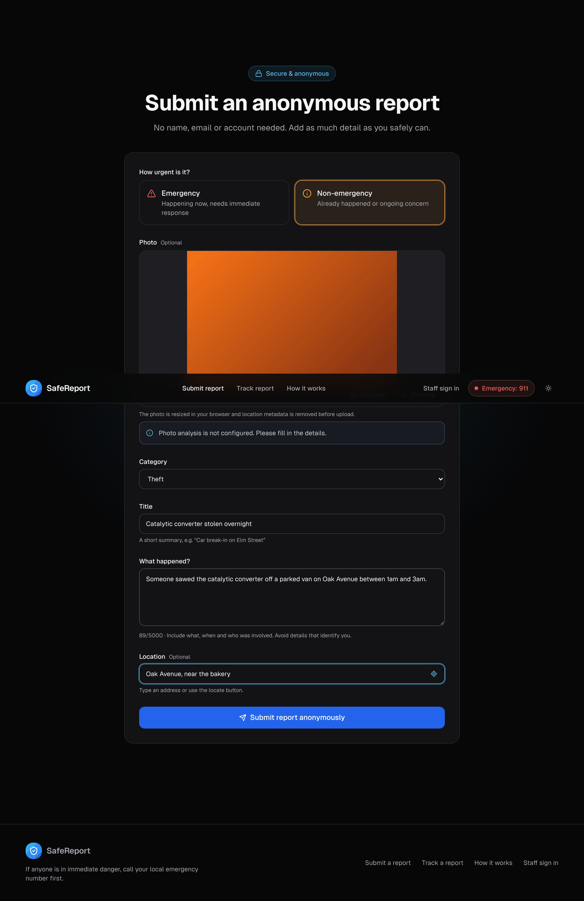
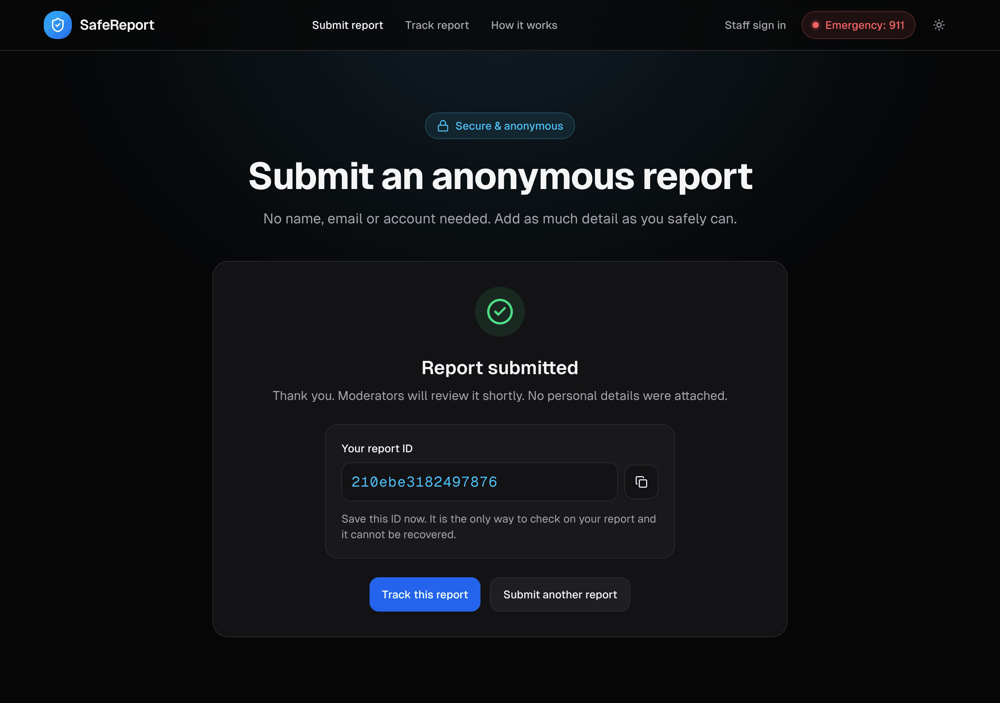
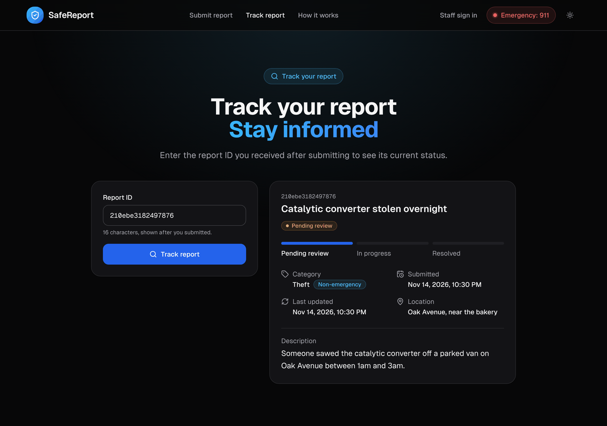
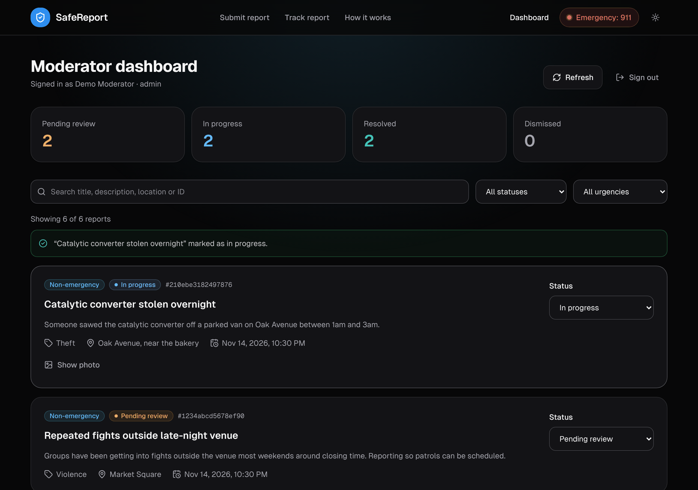
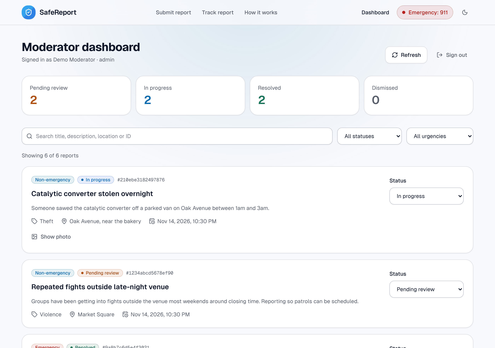
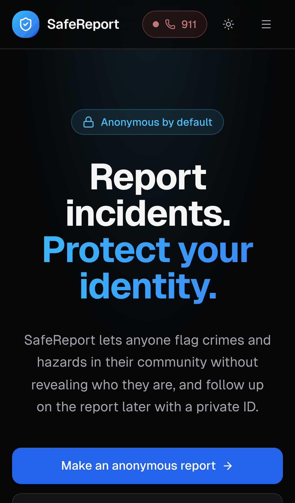
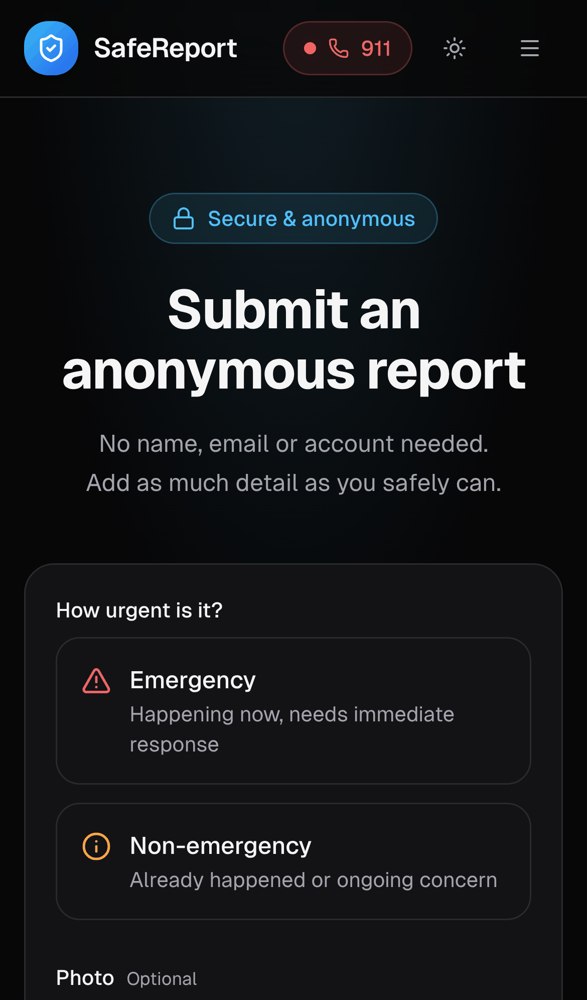
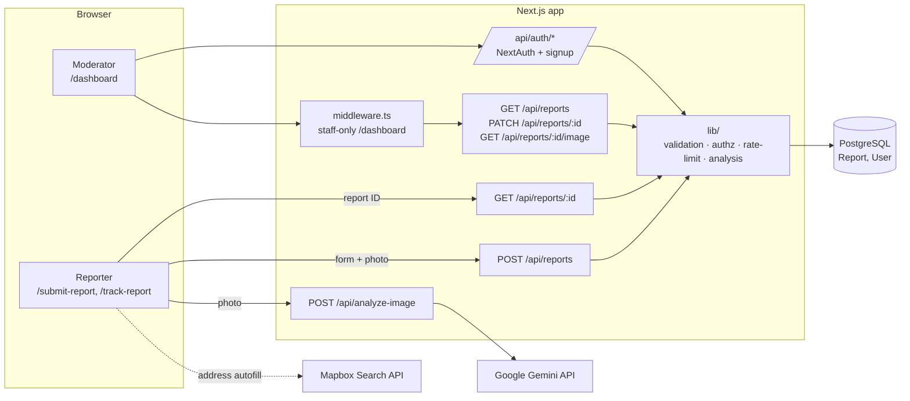

<div align="center">

# iWitness · SafeReport

**Anonymous incident reporting with photo-assisted drafting, private status tracking and a moderator dashboard.**




</div>

---

## Table of contents

- [Overview](#overview)
- [Screenshots](#screenshots)
- [Features](#features)
- [Tech stack](#tech-stack)
- [Architecture](#architecture)
- [Project structure](#project-structure)
- [Getting started](#getting-started)
- [Configuration](#configuration)
- [Running in development and production](#running-in-development-and-production)
- [Usage](#usage)
- [Scripts](#scripts)
- [API reference](#api-reference)
- [Testing](#testing)
- [Linting and formatting](#linting-and-formatting)
- [Deployment](#deployment)
- [Security notes](#security-notes)
- [Troubleshooting / FAQ](#troubleshooting--faq)
- [Known limitations and roadmap](#known-limitations-and-roadmap)
- [Contributing](#contributing)
- [License and credits](#license-and-credits)

## Overview

People often witness crimes or hazards but don't report them because they're afraid of being identified. **SafeReport** lowers that barrier:

- **Reporters** file a report without creating an account or giving a name, email or phone number. They can attach a photo, which an AI model (Google Gemini) uses to draft the title, category and description. They get a random **report ID** they can use later to check the status.
- **Moderators** (staff accounts) sign in to a dashboard to triage incoming reports, filter them by status and urgency, view attached photos and update progress.

It is a full-stack Next.js App Router application backed by PostgreSQL via Prisma, suitable as a starting point for community-safety, campus, workplace or NGO reporting tools.

## Screenshots

All screenshots were captured from the running app using the bundled demo seed data.

| Submit a report                                                                                                                               | Report submitted                                                                                                                      |
| --------------------------------------------------------------------------------------------------------------------------------------------- | ------------------------------------------------------------------------------------------------------------------------------------- |
|  |  |

| Track a report                                                                                                      | Moderator dashboard                                                                                                   |
| ------------------------------------------------------------------------------------------------------------------- | --------------------------------------------------------------------------------------------------------------------- |
|  |  |

| Dashboard (light theme)                                                                       | Mobile home                                                                           | Mobile form                                                                               |
| --------------------------------------------------------------------------------------------- | ------------------------------------------------------------------------------------- | ----------------------------------------------------------------------------------------- |
|  |  |  |

## Features

**For reporters**

- Anonymous submission: no account, no personal details, and no IP address is stored with a report.
- Emergency / non-emergency urgency selection and six incident categories.
- **Photo-assisted drafting**: upload a photo and Gemini fills in an editable title, category and description. If no API key is configured, the form says so and keeps working.
- Photos are downscaled and re-encoded **in the browser** before upload, which also strips EXIF metadata such as GPS position and camera model.
- Location by Mapbox address autocomplete (optional) or one-tap browser geolocation.
- A server-generated, unguessable 16-character report ID with a copy button and a deep link to the tracking page.
- Public status tracking with a progress indicator. It never exposes the photo or exact coordinates.

**For moderators**

- Credentials sign-in (NextAuth.js, JWT sessions, bcrypt-hashed passwords).
- Dashboard with per-status totals, server-side status/urgency filters, client-side text search, lazy-loaded photos and OpenStreetMap links for coordinates.
- Optimistic status updates with rollback and inline feedback.
- Role-based access: only `ADMIN` and `MODERATOR` can use the dashboard or the staff APIs.

**Quality**

- Light and dark themes (follows system preference, toggle persisted), WCAG AA colour tokens, visible focus rings, skip link, labelled controls, `aria-live` status messages and reduced-motion support.
- Responsive from 375 px phones to wide desktops.
- Loading skeletons, empty states, error states with retry, friendly validation messages, a custom 404 page and an error boundary.
- Input validation with zod on both client and server, request-size limits, basic rate limiting and security headers.

## Tech stack

| Layer      | Technology                                                                                                  |
| ---------- | ----------------------------------------------------------------------------------------------------------- |
| Framework  | [Next.js 15](https://nextjs.org/) (App Router, Route Handlers, Middleware)                                  |
| UI         | React 19, Tailwind CSS 3, `class-variance-authority`, [lucide-react](https://lucide.dev/) icons, Geist font |
| Language   | TypeScript (strict)                                                                                         |
| Database   | PostgreSQL (Neon, Supabase, RDS or local) via [Prisma 5](https://www.prisma.io/)                            |
| Auth       | [NextAuth.js 4](https://next-auth.js.org/) credentials provider, JWT sessions, bcryptjs                     |
| Validation | [zod 4](https://zod.dev/) schemas shared by client and server                                               |
| AI         | [Google Gemini](https://ai.google.dev/) via `@google/genai` (default model `gemini-2.5-flash`)              |
| Maps       | [Mapbox Search JS](https://docs.mapbox.com/mapbox-search-js/) address autofill (optional)                   |
| Testing    | [Vitest](https://vitest.dev/)                                                                               |
| Tooling    | ESLint (`next/core-web-vitals`, `next/typescript`), Prettier with Tailwind plugin                           |

## Architecture



**Request flow for a new report:** the browser validates the form with the shared zod schema → `POST /api/reports` re-validates, rate-limits and generates the report ID with `crypto.randomBytes` → Prisma inserts the row → the ID is returned once to the reporter.

**Data model** (`prisma/schema.prisma`):

| Model    | Key fields                                                                                                                                                                                                                                                |
| -------- | --------------------------------------------------------------------------------------------------------------------------------------------------------------------------------------------------------------------------------------------------------- |
| `Report` | `reportId` (public, unique), `type` (`EMERGENCY`/`NON_EMERGENCY`), `reportType` (category), `title`, `description`, `location`, `latitude`, `longitude`, `image` (base64 data URL), `status` (`PENDING`/`IN_PROGRESS`/`RESOLVED`/`DISMISSED`), timestamps |
| `User`   | `email` (unique), `name`, `password` (bcrypt hash), `role` (`ADMIN`/`MODERATOR`/`USER`)                                                                                                                                                                   |

## Project structure

```text
.
├── app/                         # Next.js App Router
│   ├── api/
│   │   ├── analyze-image/       # POST: Gemini photo analysis
│   │   ├── auth/
│   │   │   ├── [...nextauth]/   # NextAuth handlers (uses lib/auth.ts)
│   │   │   └── signup/          # POST: create a USER account
│   │   └── reports/
│   │       ├── route.ts         # POST create (public), GET list (staff)
│   │       └── [reportId]/
│   │           ├── route.ts     # GET public status, PATCH status (staff)
│   │           └── image/       # GET attached photo (staff)
│   ├── auth/signin|signup/      # Staff auth pages
│   ├── dashboard/               # Moderator dashboard (protected by middleware)
│   ├── how-it-works/            # Process and privacy explainer
│   ├── submit-report/           # Report form
│   ├── track-report/            # Status lookup
│   ├── layout.tsx               # Fonts, metadata, theme script, navbar/footer
│   ├── not-found.tsx, error.tsx # 404 and error boundary
│   ├── icon.svg, opengraph-image.tsx, robots.ts
│   └── globals.css              # Design tokens (light + dark)
├── components/
│   ├── ui/                      # Design-system primitives (Button, Field, Card, Badge, Alert…)
│   ├── site/                    # Navbar, footer, logo, theme toggle
│   ├── report/                  # Report form, location input, tracker, status badges
│   ├── dashboard/               # Report card
│   └── auth/                    # Sign-in/up forms
├── lib/
│   ├── auth.ts                  # NextAuth options + credential verification
│   ├── authz.ts                 # requireStaff() guard for route handlers
│   ├── validation.ts            # zod schemas shared by client and server
│   ├── analysis.ts              # Gemini prompt + response parser
│   ├── rate-limit.ts            # In-memory fixed-window limiter
│   ├── http.ts                  # JSON body parsing/limits + error helpers
│   ├── report-id.ts             # Secure report ID generation
│   ├── reports.ts               # Prisma select sets (public vs staff)
│   ├── image-client.ts          # Browser-side image downscaling
│   ├── constants.ts, utils.ts, prisma.ts
├── prisma/
│   ├── schema.prisma            # Database schema
│   └── seed.ts                  # Demo admin + fictional reports
├── scripts/create-admin.ts      # Create or promote a staff account
├── tests/                       # Vitest unit + route-handler tests
├── types/next-auth.d.ts         # Session/JWT type augmentation
├── docs/screenshots/            # README screenshots
├── middleware.ts                # Dashboard access control
└── .env.example                 # All supported environment variables
```

## Getting started

### Prerequisites

- **Node.js 22.12+** (LTS) and npm 10+
- **PostgreSQL 14+**: a local install, Docker, or a hosted database such as [Neon](https://neon.tech/)
- Optional: a [Google Gemini API key](https://aistudio.google.com/app/apikey) and a [Mapbox public token](https://account.mapbox.com/access-tokens/)

### Installation

```bash
# 1. Clone and install
git clone https://github.com/jeevithg090/iwitness-app.git
cd iwitness-app
npm install            # also runs `prisma generate`

# 2. Configure environment
cp .env.example .env   # then edit DATABASE_URL and NEXTAUTH_SECRET
openssl rand -base64 32   # paste the output into NEXTAUTH_SECRET

# 3. (Optional) start a local Postgres with Docker
docker run -d --name safereport-db -p 5432:5432 \
  -e POSTGRES_PASSWORD=postgres -e POSTGRES_DB=safereport postgres:16

# 4. Create the tables and load demo data
npm run db:push
npm run db:seed        # admin@example.com / change-me-please (override via SEED_ADMIN_*)

# 5. Start the dev server
npm run dev            # http://localhost:3000
```

To create a real staff account instead of (or in addition to) the demo one:

```bash
npm run create-admin -- you@example.org 'a-strong-password' "Your Name" ADMIN
# role can be ADMIN or MODERATOR; running it again for an existing email updates password/role
```

## Configuration

All variables are listed in [`.env.example`](.env.example).

| Variable                          | Required             | Default                 | Description                                                                                                                                                                                       |
| --------------------------------- | -------------------- | ----------------------- | ------------------------------------------------------------------------------------------------------------------------------------------------------------------------------------------------- |
| `DATABASE_URL`                    | **Yes**              | none                    | PostgreSQL connection string used by Prisma.                                                                                                                                                      |
| `NEXTAUTH_SECRET`                 | **Yes** (production) | none                    | Secret used to sign session JWTs. Generate with `openssl rand -base64 32`.                                                                                                                        |
| `NEXTAUTH_URL`                    | Recommended          | `http://localhost:3000` | Public base URL of the app. Also used as `metadataBase` for Open Graph URLs.                                                                                                                      |
| `GEMINI_API_KEY`                  | No                   | empty                   | Enables photo analysis. Without it `/api/analyze-image` returns 503 and the form shows a friendly note.                                                                                           |
| `GEMINI_MODEL`                    | No                   | `gemini-2.5-flash`      | Gemini model used for photo analysis.                                                                                                                                                             |
| `NEXT_PUBLIC_MAPBOX_ACCESS_TOKEN` | No                   | empty                   | Public Mapbox token (`pk.*`) for address autofill. Without it, the location field is a plain input (geolocation still works). Exposed to the browser: restrict it by URL in the Mapbox dashboard. |
| `SEED_ADMIN_EMAIL`                | No                   | `admin@example.com`     | Account created by `npm run db:seed` / used by `create-admin` when no arguments are passed.                                                                                                       |
| `SEED_ADMIN_PASSWORD`             | No                   | `change-me-please`      | Password for the seeded account. **Change it** for anything other than local development.                                                                                                         |

## Running in development and production

```bash
# Development (hot reload)
npm run dev

# Production
npm run build          # prisma generate + next build
npm start              # serves on PORT (default 3000)
```

## Usage

### UI walkthrough

1. **Submit**: open `/submit-report`, choose _Emergency_ or _Non-emergency_, optionally add a photo (fields are drafted if Gemini is configured), pick a category, write a title and description, optionally add a location, and submit.
2. **Save the ID**: the confirmation screen shows the report ID (e.g. `a1b2c3d4e5f60718`) with a copy button.
3. **Track**: open `/track-report`, paste the ID (or follow the _Track this report_ link) to see status, category, dates and description.
4. **Moderate**: sign in at `/auth/signin` with a staff account, then use `/dashboard` to filter, search, view photos and change statuses.

With the seed data loaded you can try tracking `a1b2c3d4e5f60718` (in progress) or `5c4b3a29180f7e6d` (resolved).

### API examples

Submit a report:

```bash
curl -X POST http://localhost:3000/api/reports \
  -H 'Content-Type: application/json' \
  -d '{
    "type": "NON_EMERGENCY",
    "category": "Theft",
    "title": "Bicycle stolen outside library",
    "description": "Lock was cut between 2pm and 4pm; blue road bike.",
    "location": "Main Library, east entrance"
  }'
```

```json
{
  "reportId": "e2d3dafe127bde1b",
  "status": "PENDING",
  "createdAt": "2026-11-14T22:28:03.512Z"
}
```

Validation errors return `422` with per-field messages:

```json
{
  "error": "Please check the highlighted fields",
  "fields": { "title": "Title must be at least 3 characters" }
}
```

Look up a report:

```bash
curl http://localhost:3000/api/reports/a1b2c3d4e5f60718
```

```json
{
  "reportId": "a1b2c3d4e5f60718",
  "type": "EMERGENCY",
  "reportType": "Fire Outbreak",
  "title": "Smoke coming from warehouse roof",
  "description": "Thick grey smoke is rising from the roof…",
  "location": "Riverside Industrial Park, Unit 4",
  "status": "IN_PROGRESS",
  "createdAt": "2026-11-14T22:16:41.000Z",
  "updatedAt": "2026-11-14T22:16:41.000Z"
}
```

Staff endpoints use the NextAuth session cookie, so they're easiest to exercise through the dashboard.

## Scripts

| Command                                                                | Description                                           |
| ---------------------------------------------------------------------- | ----------------------------------------------------- |
| `npm run dev`                                                          | Start the Next.js dev server.                         |
| `npm run build`                                                        | Generate the Prisma client and build for production.  |
| `npm start`                                                            | Serve the production build.                           |
| `npm run lint`                                                         | ESLint over all TS/TSX files (zero warnings allowed). |
| `npm run typecheck`                                                    | `tsc --noEmit` in strict mode.                        |
| `npm run format` / `format:check`                                      | Write / verify Prettier formatting.                   |
| `npm test` / `test:watch`                                              | Run the Vitest suite once / in watch mode.            |
| `npm run db:push`                                                      | Sync `prisma/schema.prisma` to the database.          |
| `npm run db:seed`                                                      | Seed a demo admin and five fictional reports.         |
| `npm run db:studio`                                                    | Open Prisma Studio.                                   |
| `npm run create-admin -- <email> <password> [name] [ADMIN\|MODERATOR]` | Create or promote a staff account.                    |

## API reference

| Method       | Path                           | Auth                                   | Description                                                                                                                                                                                               |
| ------------ | ------------------------------ | -------------------------------------- | --------------------------------------------------------------------------------------------------------------------------------------------------------------------------------------------------------- |
| `POST`       | `/api/reports`                 | Public (rate-limited 10 / 10 min / IP) | Create a report. Body: `type`, `category`, `title`, `description`, optional `location`, `latitude`, `longitude`, `image` (JPEG/PNG/WebP data URL ≤ ≈3 MB). Returns `201 { reportId, status, createdAt }`. |
| `GET`        | `/api/reports/:reportId`       | Public (rate-limited 30 / min / IP)    | Public status of a report (no photo, no coordinates). `400` bad ID, `404` not found.                                                                                                                      |
| `GET`        | `/api/reports?status=&type=`   | `ADMIN` / `MODERATOR`                  | Up to 200 newest reports (without image data) plus `hasImage` flags and per-status `counts`.                                                                                                              |
| `PATCH`      | `/api/reports/:reportId`       | `ADMIN` / `MODERATOR`                  | Update status. Body: `{ "status": "PENDING" \| "IN_PROGRESS" \| "RESOLVED" \| "DISMISSED" }`.                                                                                                             |
| `GET`        | `/api/reports/:reportId/image` | `ADMIN` / `MODERATOR`                  | The attached photo as binary with its MIME type.                                                                                                                                                          |
| `POST`       | `/api/analyze-image`           | Public (rate-limited 10 / 10 min / IP) | Body `{ image }` (data URL). Returns `{ title, category, description }`. `503` when Gemini isn't configured.                                                                                              |
| `POST`       | `/api/auth/signup`             | Public (rate-limited 5 / 15 min / IP)  | Create a `USER` account (`name`, `email`, `password`). Role is always `USER`.                                                                                                                             |
| `GET`/`POST` | `/api/auth/*`                  | n/a                                    | NextAuth endpoints (sign-in, session, CSRF, sign-out).                                                                                                                                                    |

Errors are always JSON: `{ "error": string, "fields"?: Record<string, string> }`.

## Testing

```bash
npm test
```

The Vitest suite (48 tests) covers the core logic without needing a database. Prisma and `getServerSession` are mocked:

- **Validation** (`tests/validation.test.ts`): report, signup, status and ID schemas; client-controlled fields such as `reportId`, `status` and `role` are stripped.
- **AI parsing** (`tests/analysis.test.ts`): parsing Gemini output, markdown tolerance, category matching, data URL splitting.
- **Report IDs, rate limiter, JSON body parsing**: format/uniqueness, windows and resets, 400/413/422 handling.
- **Route handlers** (`tests/api-reports.test.ts`, `tests/api-auth.test.ts`): server-generated IDs, 401/403 for anonymous and `USER` callers on staff routes, public lookups never selecting photos or coordinates, signup ignoring a requested `ADMIN` role, credential checks that don't reveal whether an email exists.

## Linting and formatting

```bash
npm run lint          # ESLint (next/core-web-vitals + next/typescript + prettier)
npm run typecheck     # TypeScript strict mode
npm run format:check  # Prettier (with Tailwind class sorting)
```

## Deployment

The app is a standard Next.js server and needs a PostgreSQL database.

**Vercel (recommended by the original project)**

1. Create a PostgreSQL database (e.g. Neon) and copy its connection string.
2. Import the repository in Vercel. The default build command `npm run build` already runs `prisma generate`.
3. Set `DATABASE_URL`, `NEXTAUTH_SECRET` and `NEXTAUTH_URL` (your production URL), plus the optional `GEMINI_API_KEY`, `GEMINI_MODEL` and `NEXT_PUBLIC_MAPBOX_ACCESS_TOKEN`.
4. Create the schema once from your machine: `DATABASE_URL=… npm run db:push`.
5. Create a staff account: `DATABASE_URL=… npm run create-admin -- you@org.example 'strong-password'`.

**Any Node host / container**

```bash
npm ci
npm run build
npx prisma db push      # or manage migrations with `prisma migrate`
npm start               # respects PORT
```

Serve it behind HTTPS. The app sends `Strict-Transport-Security` and other security headers (see `next.config.mjs`).

## Security notes

- Staff roles are never accepted from the client. Grant them with `npm run create-admin` or directly in the database.
- All staff APIs check the role server-side (`lib/authz.ts`), not just the middleware.
- Report IDs are 64-bit random values from `crypto.randomBytes`, generated on the server.
- Sign-in returns the same error for unknown emails and wrong passwords.
- Request bodies are size-limited and validated; images must be JPEG/PNG/WebP data URLs.
- Never commit `.env`. If a real secret was ever committed in your fork, rotate it.

## Troubleshooting / FAQ

<details>
<summary><strong><code>PrismaClientInitializationError: Can't reach database server</code></strong></summary>

Check `DATABASE_URL`, make sure Postgres is running (`docker ps`), and that the database exists. Hosted providers such as Neon usually need `?sslmode=require`.
</details>

<details>
<summary><strong><code>The table public.Report does not exist</code></strong></summary>

Run `npm run db:push` to create the tables.
</details>

<details>
<summary><strong>I can sign in but the dashboard sends me back to sign-in with "does not have moderator access"</strong></summary>

Your account has the `USER` role. Promote it with `npm run create-admin -- your@email 'password' "Name" MODERATOR`.
</details>

<details>
<summary><strong>Photo analysis says "not configured"</strong></summary>

Set `GEMINI_API_KEY` and restart the server. If you get "analysis failed", check that the key is valid and that `GEMINI_MODEL` names a model your key can access.
</details>

<details>
<summary><strong>No address suggestions appear</strong></summary>

Set `NEXT_PUBLIC_MAPBOX_ACCESS_TOKEN` _before_ building: `NEXT_PUBLIC_*` values are inlined at build time.
</details>

<details>
<summary><strong>"Use my current location" does nothing</strong></summary>

Browsers only allow geolocation on HTTPS or `localhost`, and only after the user grants permission.
</details>

<details>
<summary><strong><code>[next-auth][warn][NO_SECRET]</code> or sessions break in production</strong></summary>

Set `NEXTAUTH_SECRET` and `NEXTAUTH_URL` in the production environment.
</details>

## Known limitations and roadmap

**Known limitations**

- Photos are stored as base64 strings in PostgreSQL. This is fine for small deployments but inefficient at scale.
- Rate limiting is in-memory per server instance. On serverless or multi-instance hosting, put a shared store (Redis/Upstash) or a WAF in front.
- Your hosting provider or reverse proxy may log IP addresses in access logs; the app itself does not store them with reports.
- The dashboard loads the 200 most recent reports matching the filters (no pagination yet).
- There is no two-way messaging between moderators and reporters, and no notifications for new reports.
- The emergency shortcut dials `911`; change it in `components/site/navbar.tsx` for other regions.
- Staff roles are managed from the CLI; there is no admin UI for user management.

**Roadmap ideas**

- Object storage (S3/R2) for photos, plus multiple attachments.
- Pagination and CSV export in the dashboard; moderator notes and an audit log.
- Anonymous two-way messaging keyed by report ID.
- Email/Slack notifications for new emergency reports.
- Shared rate limiting and CAPTCHA for public endpoints.
- Prisma migrations and end-to-end tests in CI.
- Internationalisation and configurable emergency numbers.

## Contributing

1. Fork the repo and create a feature branch.
2. Install dependencies and set up `.env` as described above.
3. Keep `npm run lint`, `npm run typecheck`, `npm run format:check` and `npm test` passing.
4. Use [Conventional Commits](https://www.conventionalcommits.org/) (`feat:`, `fix:`, `docs:` …) and open a pull request describing the change and how you tested it.

## License and credits

This repository is a fork of the **Anonymous Crime Reporting App** by [mendsalbert](https://github.com/mendsalbert), originally built as a Next.js 14 tutorial project. Credit for the original concept, design and implementation goes to the original author.

The upstream project does not include a license file, so no license is granted here by default. If you plan to reuse or redistribute this code, check with the original author. A permissive license such as MIT would be a sensible choice if they agree.
